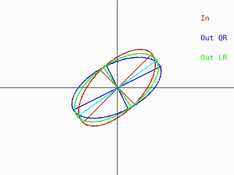

# Visualising QR and LR iteration

An interactive Python visualisation of one QR step and one LR (Cholesky) step on a positive-definite symmetric 2×2 matrix.

The input and output matrices are drawn as ellipses. Changing the input lets you see how each iteration changes its principal axes and how the diagonal matrices appear as fixed points.



## Run the visualisation

Requires Python 3, NumPy and Pygame. From the repository directory:

```sh
python -m pip install numpy pygame
python src/qr_lr.py
```

Press any key at the introduction screen, then use:

| Control | Action |
| --- | --- |
| Left / right arrows | Rotate the input ellipse |
| Up / down arrows | Adjust its second semiaxis |

The input is red, the QR output is blue, and the LR output is green. Keep the second semiaxis positive: the Cholesky step requires a positive-definite matrix.

## How it works

For the QR step, the program factors the input as `A = QR`, with positive diagonal entries in `R`, and displays `RQ`.

For the LR step, it computes the Cholesky factorisation `A = LLᵀ` and displays `LᵀL`.

Each output has the same eigenvalues as the input. The visualisation shows a single iteration as the input varies.

The implementation is in [src/qr_lr.py](src/qr_lr.py).

